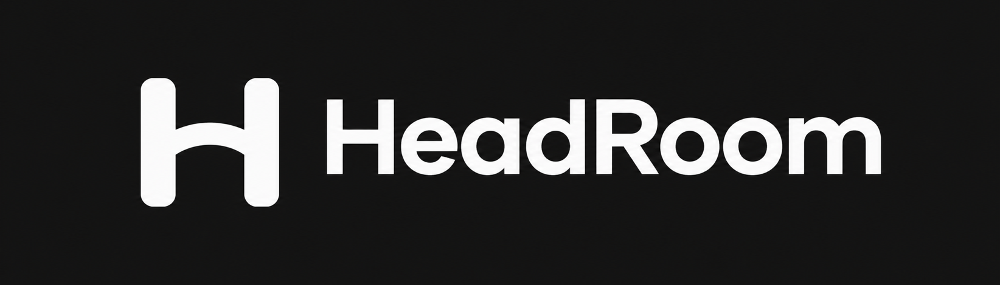
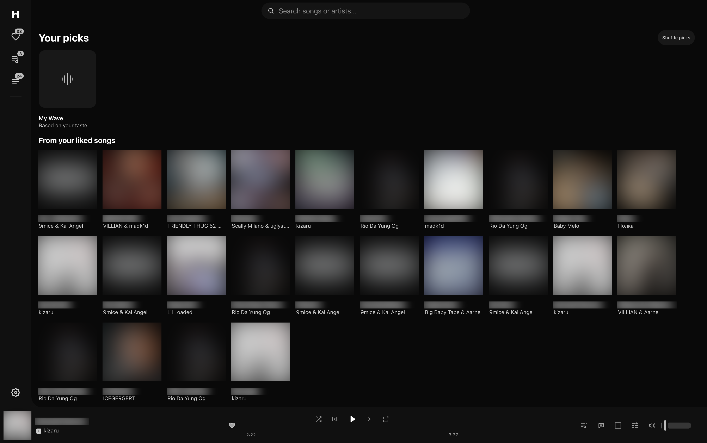
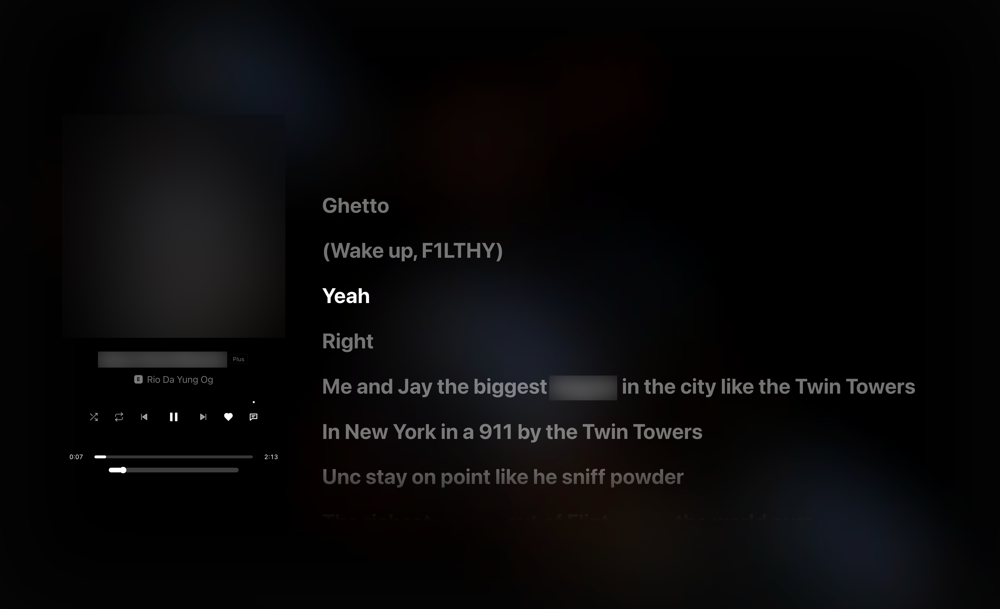
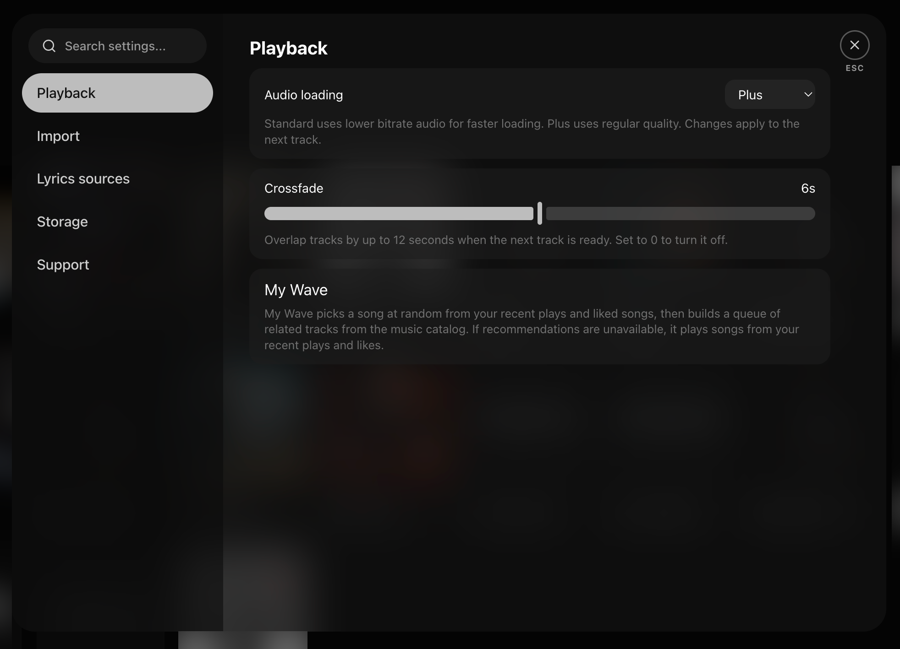

  

<h1 align="center">HeadRoom</h1>

An open-source music player for Mac with Apple Silicon. Now in public beta.

  <a href="https://github.com/Marat-ctrl/HeadRoom/releases">Download</a> ·
  <a href="https://github.com/Marat-ctrl/HeadRoom/issues">Report a bug</a> ·
  <a href="https://www.donationalerts.com/r/sh4wty9">Support HeadRoom</a>

## Download

Get the [latest beta](https://github.com/Marat-ctrl/HeadRoom/releases) for Mac with Apple Silicon (ARM64).

1. Download and open the **DMG**.
2. Drag **HeadRoom** into **Applications**.
3. Open HeadRoom from **Applications**.

The **ZIP** is also available on the release page. Extract it and move **HeadRoom.app** to **Applications**.

This beta uses an ad-hoc signature and is not notarized. If macOS blocks it on first launch, try opening it once, then go to **System Settings → Privacy & Security → Open Anyway**.

## Features

- Live search across songs, albums and artists, with separate tabs and popularity sorting where data is available.
- Liked songs, saved albums and artists, playlists, a queue and My Wave recommendations.
- Standard and Plus audio modes, crossfade and audio effects.
- Lyrics in the side panel and the expanded player. Synchronized lyrics are shown when matching timestamps are available.
- Playlist import from public Spotify, Yandex Music and VK Music links where track data is available.

Playback and import availability depend on the source services. Report beta issues on [GitHub Issues](https://github.com/Marat-ctrl/HeadRoom/issues).

## Screenshots

### Home and My Wave

### Expanded player

### Playback settings

## Support HeadRoom

If you enjoy using HeadRoom, you can help support its development. [Donate on DonationAlerts](https://www.donationalerts.com/r/sh4wty9) · [Creator page](https://www.donationalerts.com/c/sh4wty9)

## Development

On macOS with Apple Silicon, run `npm ci`, `npm run tools:prepare`, then `npm start`. Run `npm test` for the test suite. Run `npm run preview:mac` to build the ARM64 app in `dist/mac-arm64`.

## Credits and licensing

HeadRoom is based on [Riff](https://github.com/rootscripts/riff) by **rootscripts (rootless)**. It reuses parts of Riff's Electron player, playback code and interface, with changes for HeadRoom. The original code and HeadRoom's modifications are distributed under the [MIT License](LICENSE), which preserves the upstream copyright notice.

Bundled tools keep their own licenses. See [Third-party tools and corresponding source](THIRD_PARTY_TOOLS.md).
